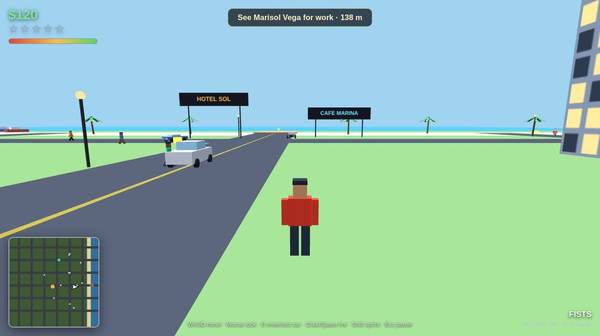
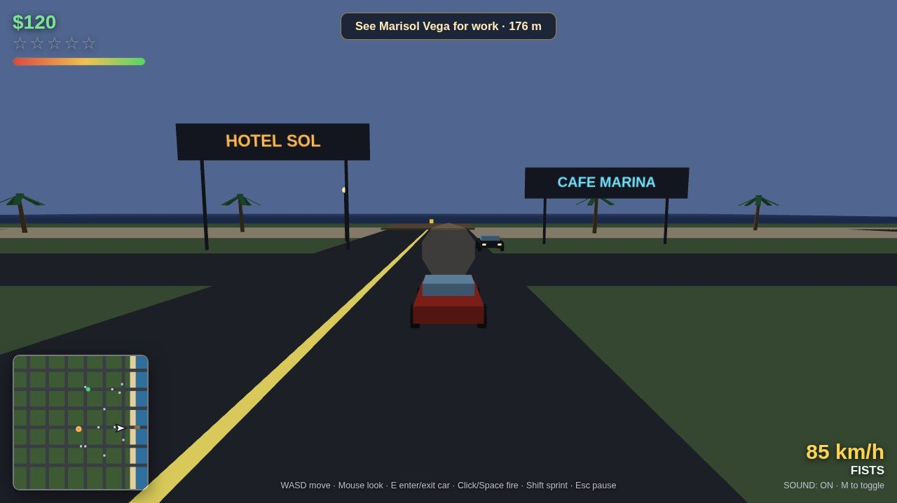
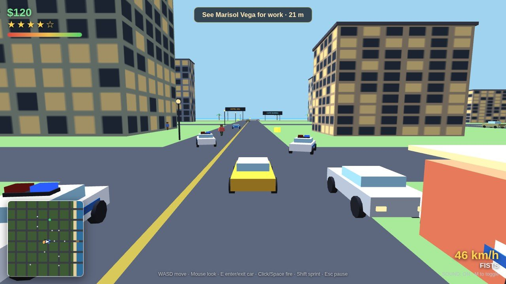
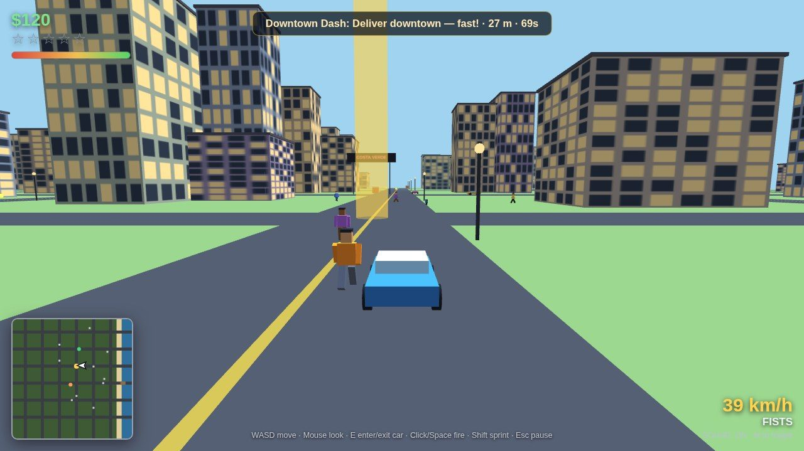

# Costa Verde Heat

[](https://make.fun/bounty/gta6-01)
[](#how-to-play)
[](#tech)

A **third-person 3D open-world crime game** in the fictional coastal city of
Costa Verde — built from scratch for the
[make.fun gta6-01 bounty](https://make.fun/bounty/gta6-01). Run jobs for fixer
**Marisol Vega**, steal anything with wheels, outrun a five-star wanted system,
and watch the city slide from day into a neon dusk.



## What's in the city

- **Third-person character** with procedural walk animation, orbit camera on
  foot and a chase camera in cars (pointer-lock mouse look)
- **Six story jobs** — pickups, a car theft, timed deliveries, a heat run and a
  final score at the end of the pier — ending screen included, free roam after
- **Wanted system**: heat, 0–5 stars, pursuit AI, bust meter, BUSTED/WASTED
  respawns at the police station and hospital
- **Six vehicle types** (sedan, coupe, sport, truck, van, motorcycle), traffic
  AI, parked cars — enter and drive any of them, police cruisers included
- **Side work**: taxi fares, Pay 'n Spray repairs that also shake your heat,
  food stands that heal, 14 hidden cash packages
- **Combat**: fists, a pistol and an SMG, all synthesised WebAudio sound (M mutes)
- **A living city**: 40 pedestrians, day→dusk cycle over ~7 minutes, lit
  windows and glowing signs at dusk, marina, beach and pier
- **A living title screen**: the menu floats over the city still simulating,
  with a cinematic orbiting camera at golden hour
- **Save game** in localStorage (pause menu), minimap with a player arrow that
  actually points where you're facing

## How to play

Open `game/index.html` in a desktop browser (everything is static and offline;
Three.js is vendored under `game/vendor/`), or serve the folder:

```sh
node serve.ts   # then open http://localhost:8080
```

| Keys | Action |
| --- | --- |
| WASD / arrows | Move / drive (A and D strafe) |
| Mouse | Look — click the game to pointer-lock |
| Shift | Sprint |
| E | Enter / exit car, use a food stand |
| Click / Space | Fire weapon (or punch with fists) |
| 1 / 2 / 3 | Fists / pistol / SMG |
| M | Mute |
| Esc / P | Pause (save from the pause menu) |

## Screenshots

| | |
| --- | --- |
|  |  |
| Driving the coast avenue at dusk | Four stars and the cruisers closing in |
|  | Timed job: gold pillar, banner, clock |

## Tech

- Three.js 0.147 (vendored UMD, `game/vendor/three.min.js`), plain scripts —
  no build step, no network
- Delta-time simulation (frame-rate independent), seeded city generation
- `main.ts` packages the entry: it copies `game/` and `screenshots/` to the
  output directory and writes `dossier.json` via `vendor/makefun-game.ts`
